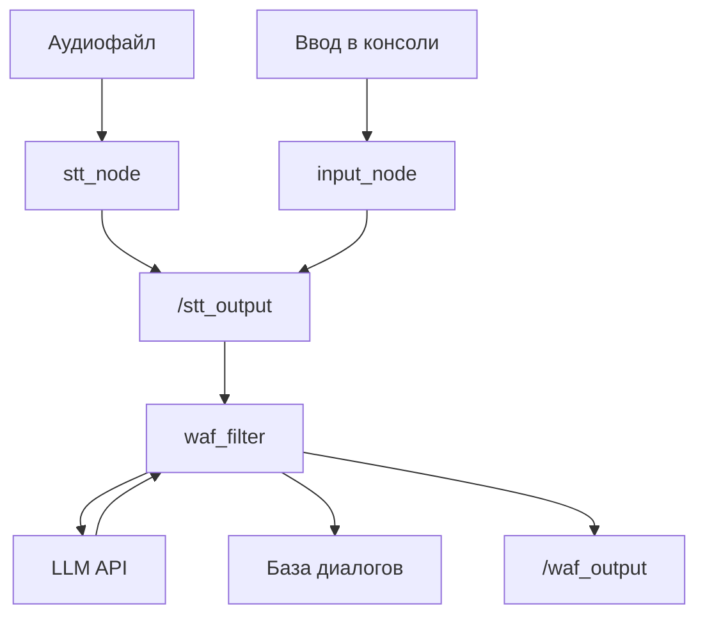

# Companion

**Экспериментальный голосовой ассистент на Python и ROS 2: локальное распознавание речи, обработка запросов через LLM и сохранение диалогов.**

Companion — проект для изучения того, как собрать голосового собеседника из отдельных компонентов. Он объединяет работу с микрофоном, подготовку аудио, распознавание речи и обращение к языковой модели. ROS 2 используется для обмена сообщениями между узлами.

Проект находится в разработке. В репозитории есть обработка аудиофайла и отдельный прототип потокового захвата; непрерывный голосовой диалог пока не реализован.

> Репозиторий называется `companion`, а Python- и ROS-пакет — `lwitch`. Это имя сохраняется в импортах, сборке и командах `ros2 run`.

## Что уже реализовано

- **Захват звука:** запись WAV и отдельный потоковый прототип с ограниченными очередями аудио.
- **Подготовка аудио:** преобразование моносигнала с 48 кГц до 16 кГц и разбиение на кадры по 480 отсчётов — 30 мс при 16 кГц. Остаток данных сохраняется между вызовами.
- **Speech-to-text:** локальное распознавание через `faster-whisper`, определение языка и временных границ сегментов.
- **LLM:** запросы к API, совместимому с OpenAI, через Python SDK. Провайдер и модель задаются в `.env`.
- **Фильтрация ввода:** нормализация текста, поиск SQL-подобных шаблонов и ограничение частоты запросов.
- **Хранение:** модель диалога и операции записи через SQLAlchemy; SQLite для локального запуска или PostgreSQL.
- **VAD:** отдельный эксперимент с Silero VAD для поиска участков речи в файле.

## Как устроен обмен сообщениями

Текущая схема обработки текста и заранее записанного аудио:



`stt_node` распознаёт один файл при запуске. `input_node` позволяет проверить текстовую часть без микрофона и Whisper. `waf_filter` проверяет запрос, вызывает LLM, сохраняет запись и публикует текст запроса вместе с ответом.

Потоковый узел `voice_input` пока существует отдельно: он складывает PCM-кадры в очередь и публикует уведомление в `/voice_input`, но STT эту очередь и уведомление ещё не обрабатывает. Подробнее — в [описании архитектуры](docs/architecture.md).

## Почему faster-whisper

Распознавание выполняется локально, поэтому для него не нужен отдельный STT API. В текущем коде используется модель `base` на CPU с `compute_type="int8"`: можно экспериментировать без обязательной NVIDIA GPU. `faster-whisper` использует CTranslate2 и возвращает сегменты с текстом и временными отметками.

Это выбор реализации STT; измерений задержки и качества на конкретном оборудовании в репозитории пока нет. GPU-режим потребует отдельной настройки совместимых CUDA-библиотек: они не устанавливаются как обязательные зависимости CPU-варианта.

## Структура

| Путь | Назначение |
| --- | --- |
| `lwitch/audio/` | Микрофон, очереди, запись WAV, ресемплинг и кадры |
| `lwitch/stt/` | Распознавание файлов и эксперимент с VAD |
| `lwitch/nodes/` | ROS-узлы; адаптеры над компонентами |
| `lwitch/llm/` | Клиент языковой модели |
| `lwitch/waf/` | Фильтрация текста, лимиты и файловый лог |
| `lwitch/database/` | SQLAlchemy: подключение, модель и запись диалогов |
| `docs/` | Архитектура и сохранённый черновик интерфейса |
| `tests/` | Проверки аудиокомпонентов, фильтров и ROS lint |
| `resource/lwitch`, `package.xml`, `setup.cfg` | Регистрация и настройка ROS-пакета |
| `setup.py`, `pyproject.toml`, `requirements.txt` | Установка Python-пакета |
| `.env.example` | Пример настроек без секретов |

Аудиозаписи, базы и логи создаются локально и исключены из Git. `setup.py` — единый источник Python-зависимостей; `requirements.txt` устанавливает сам проект.

## Установка

Нужны Python **3.10+**, PortAudio и доступный микрофон для записи. Для запуска узлов также нужны установленный ROS 2 с `rclpy` и `std_msgs`, а также `colcon`.

Используй Python, совместимый с твоей установкой ROS 2: виртуальное окружение само по себе не делает `rclpy` совместимым с другой версией интерпретатора.

### Отдельные Python-компоненты

```bash
git clone https://github.com/Sa4eNecHinS/companion.git
cd companion
python3 -m venv .venv
source .venv/bin/activate
python -m pip install -r requirements.txt
cp .env.example .env
```

PortAudio устанавливается средствами ОС. ROS 2 не устанавливается через этот список Python-зависимостей.

Для эксперимента с Silero VAD:

```bash
python -m pip install -e '.[vad]'
```

### Настройки

| Переменная | Назначение |
| --- | --- |
| `API_KEY` | Ключ выбранного LLM-провайдера |
| `BASE_URL` | Адрес его OpenAI-совместимого API |
| `LLM_MODEL` | Идентификатор модели у провайдера |
| `DATABASE_URL` | URL SQLAlchemy для SQLite или PostgreSQL |

В `.env.example` задана локальная база `sqlite:///companion.sqlite3`. Для работы LLM заполни первые три переменные. `.env` не добавляется в Git.

Создай таблицы перед запуском фильтра; для PostgreSQL база должна уже существовать:

```bash
python -m lwitch.database.db
```

### Сборка ROS-пакета

Пример для Bash. Замени `/path/to/ros2/install/setup.bash` на файл своей установки ROS 2; для Zsh используй соответствующие `setup.zsh` и `activate`.

```bash
source /path/to/ros2/install/setup.bash
mkdir -p ~/ros2_ws/src
cd ~/ros2_ws/src
git clone https://github.com/Sa4eNecHinS/companion.git
cd ~/ros2_ws
python3 -m venv --system-site-packages .venv
source .venv/bin/activate
touch .venv/COLCON_IGNORE
cd src/companion
python -m pip install -r requirements.txt
cp .env.example .env
# Заполни настройки LLM в .env перед запуском.
python -m lwitch.database.db
cd ~/ros2_ws
colcon build --symlink-install --packages-select lwitch
source install/setup.bash
```

В каждом терминале для ROS-команд загрузи окружение ROS 2, активируй эту `.venv` и выполни `source ~/ros2_ws/install/setup.bash`. Команды ниже запускай из `~/ros2_ws/src/companion`, чтобы `.env`, база и относительные пути относились к одному каталогу.

## Запуск

### Запись и распознавание файла без ROS

```bash
python -m lwitch.audio.record --output-dir data --duration 3
python -m lwitch.stt.stt data/record.wav
```

По умолчанию выбирается системный микрофон. Его имя можно передать через `--device`. Список устройств:

```bash
python -m sounddevice
```

При первом использовании Whisper потребуется загрузить модель. После её загрузки распознавание выполняется локально.

### Текстовый запрос через ROS

Сначала запусти фильтр, затем в другом терминале — ввод:

```bash
ros2 run lwitch waf_filter
```

```bash
ros2 run lwitch input_node
```

Просмотр результата в третьем терминале:

```bash
ros2 topic echo /waf_output
```

### Аудиофайл через ROS

Оставь `waf_filter` запущенным и передай файл узлу распознавания:

```bash
ros2 run lwitch stt_node --ros-args -p audio_path:=data/record.wav
```

Результат STT поступает в `/stt_output`; обращение к LLM выполняет фильтр. Путь по умолчанию — `data/record.wav`.

### Эксперименты

```bash
python -m lwitch.stt.vad data/record.wav
ros2 run lwitch voice_input
```

VAD запускается отдельно от основного потока. `voice_input` — прототип, а не готовая команда непрерывного голосового диалога.

## Проверки

Проверки компонентов без ROS, микрофона, скачивания моделей и LLM API:

```bash
python -m unittest discover -s tests -p 'test_components.py' -v
```

Шаблонные ROS lint-проверки сохранены; для них нужны `pytest` и пакеты `ament_*` из окружения ROS 2:

```bash
colcon test --packages-select lwitch
colcon test-result --verbose
```

## Что ещё предстоит

- Соединить PCM-очередь, VAD и STT для обработки законченных реплик.
- Добавить управляемую остановку захвата: сейчас прототип останавливается после 100 блоков микрофона.
- Заменить усреднение отсчётов полноценным ресемплером с фильтрацией.
- Добавить историю сообщений к LLM-запросам и озвучивание ответа.
- Сделать сетевые вызовы неблокирующими для ROS callback.
- Исправить поле `timestamp`: сейчас в него записывается счётчик запросов.
- Проверить весь поток на реальном микрофоне и закрепить совместимые версии зависимостей.

Фильтр использует эвристики и общий лимит для `default_user`. Он может блокировать обычное обсуждение SQL и не обеспечивает защиту от prompt injection. Текстовая часть отправляет запросы выбранному LLM-провайдеру; распознавание аудио остаётся локальным.

## Лицензия

[Apache License 2.0](LICENSE).

## Документация используемых технологий

- [ROS 2](https://docs.ros.org/)
- [faster-whisper](https://github.com/SYSTRAN/faster-whisper)
- [sounddevice](https://python-sounddevice.readthedocs.io/)
- [Silero VAD](https://github.com/snakers4/silero-vad)
- [SQLAlchemy](https://docs.sqlalchemy.org/)
